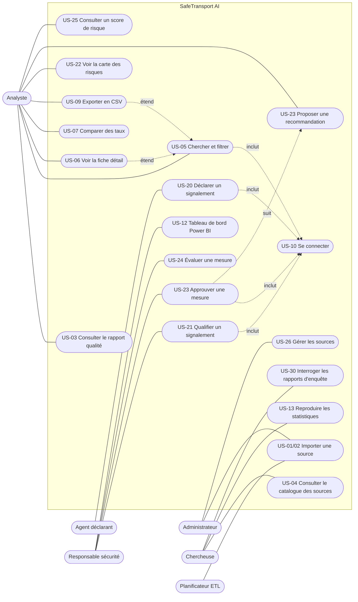

# Cas d'utilisation

Mermaid n'a pas de diagramme de cas d'utilisation : les acteurs sont à gauche, les cas
d'utilisation en ovale, avec l'identifiant de la user story du [backlog](../01-cadrage/backlog.md).

Notes :

- Tous les cas sauf US-04 et US-12 passent par la connexion (US-10). Ce n'est dessiné que pour
  quelques cas, pour garder le diagramme lisible.
- Un score de risque (US-25) ne déclenche aucune action : il n'y a pas de lien vers US-23b.
