# Diagramme de classes

Fichier généré par `db/tools/uml_classes.sql` (commande `make uml`). Ne pas modifier à la main :
changer une migration, puis régénérer. La CI vérifie que ce fichier correspond à la base.

Tables des schémas `core` et `sensitive` (données personnelles, marquées `sensitive`).
Une flèche va de la table qui porte la clé étrangère vers la table référencée.

```mermaid
classDiagram
  class accident_factors {
    bigint id PK
    bigint accident_id
    bigint incident_id
    factor_category category
    text factor_code
    text description
    assertion_level assertion_level
    confidence_level confidence
    bigint evidence_document_id
    text stated_by
    bigint data_source_id
    bigint created_by
    timestamptz created_at
    timestamptz updated_at
  }
  class accidents {
    bigint id PK
    uuid public_id
    smallint transport_mode_id
    timestamptz occurred_at
    date occurred_date
    bigint location_id
    bigint weather_condition_id
    text category
    severity_level severity
    text severity_source_label
    integer fatalities
    integer serious_injuries
    integer minor_injuries
    text summary
    bigint data_source_id
    bigint source_record_id
    text source_ref
    confidence_level confidence
    validation_status validation_status
    bigint validated_by
    timestamptz validated_at
    boolean is_simulated
    bigint created_by
    timestamptz created_at
    timestamptz updated_at
  }
  class action_evaluations {
    bigint id PK
    bigint corrective_action_id
    text indicator
    exposure_metric exposure_metric
    date before_start
    date before_end
    date after_start
    date after_end
    numeric value_before
    numeric value_after
    numeric ci_low
    numeric ci_high
    text method
    evaluation_conclusion conclusion
    bigint evaluated_by
    text notes
    timestamptz created_at
  }
  class audit_logs {
    bigint id PK
    timestamptz occurred_at
    bigint actor_user_id
    actor_type actor_type
    text action
    text table_name
    bigint row_id
    jsonb old_data
    jsonb new_data
    text request_id
    inet client_ip
  }
  class corrective_actions {
    bigint id PK
    text title
    text description
    action_kind kind
    action_origin origin
    smallint transport_mode_id
    bigint accident_id
    bigint incident_id
    bigint source_document_id
    text source_reference
    bigint target_org_id
    action_status status
    bigint proposed_by
    bigint approved_by
    timestamptz approved_at
    date due_date
    date implemented_at
    timestamptz created_at
    timestamptz updated_at
  }
  class data_sources {
    bigint id PK
    text code
    text name
    source_kind kind
    bigint provider_org_id
    smallint transport_mode_id
    char country_code
    text url
    text license
    text data_format
    text data_dictionary_url
    text known_biases
    confidence_level default_confidence
    boolean is_simulated
    validation_status validation_status
    bigint validated_by
    timestamptz validated_at
    boolean is_active
    timestamptz created_at
    timestamptz updated_at
  }
  class document_chunks {
    bigint id PK
    bigint document_id
    text chunking_version
    integer chunk_index
    integer page_start
    integer page_end
    text section_title
    text content
    tsvector content_tsv
    integer token_count
    vector embedding
    text embedding_model
    timestamptz created_at
  }
  class documents {
    bigint id PK
    text title
    document_type document_type
    bigint issuing_org_id
    smallint transport_mode_id
    char country_code
    text region
    text url
    text license
    text language
    date published_on
    text version
    char file_sha256
    integer page_count
    bigint accident_id
    bigint incident_id
    bigint data_source_id
    timestamptz ingested_at
    timestamptz created_at
  }
  class event_vehicles {
    bigint id PK
    bigint accident_id
    bigint incident_id
    bigint vehicle_id
    text role
    integer occupants
  }
  class exposure_measures {
    bigint id PK
    smallint transport_mode_id
    char country_code
    text admin1
    date period_start
    date period_end
    exposure_metric metric
    numeric value
    text unit_note
    bigint data_source_id
    confidence_level confidence
    boolean is_simulated
    timestamptz created_at
  }
  class import_jobs {
    bigint id PK
    bigint data_source_id
    import_status status
    text file_name
    char file_sha256
    text pipeline_name
    text pipeline_version
    bigint triggered_by
    timestamptz started_at
    timestamptz finished_at
    integer rows_read
    integer rows_inserted
    integer rows_updated
    integer rows_rejected
    integer rows_duplicate
    jsonb error_summary
    timestamptz created_at
  }
  class incidents {
    bigint id PK
    uuid public_id
    smallint transport_mode_id
    incident_class incident_class
    timestamptz occurred_at
    date occurred_date
    bigint location_id
    bigint weather_condition_id
    text category
    integer minor_injuries
    text summary
    bigint escalated_to_accident_id
    bigint data_source_id
    bigint source_record_id
    text source_ref
    confidence_level confidence
    validation_status validation_status
    bigint validated_by
    timestamptz validated_at
    boolean is_simulated
    bigint created_by
    timestamptz created_at
    timestamptz updated_at
  }
  class locations {
    bigint id PK
    geography geom
    location_precision precision
    char country_code
    text admin1
    text admin2
    text municipality
    text insee_code
    text site_name
    text site_code
    timestamptz created_at
  }
  class organizations {
    bigint id PK
    text name
    text acronym
    organization_kind kind
    char country_code
    text website
    timestamptz created_at
    timestamptz updated_at
  }
  class rag_queries {
    bigint id PK
    bigint user_id
    text question
    jsonb filters
    text answer
    boolean abstained
    text abstention_reason
    boolean conflicts_detected
    text llm_provider
    text llm_model
    text prompt_version
    jsonb retrieval_config
    integer latency_ms
    integer input_tokens
    integer output_tokens
    numeric cost_eur
    smallint user_rating
    boolean is_benchmark
    timestamptz created_at
  }
  class rag_query_chunks {
    bigint rag_query_id PK
    bigint chunk_id PK
    integer rank
    real lexical_score
    real vector_score
    real fused_score
    boolean cited
  }
  class report_contacts {
    <<sensitive>>
    bigint report_id PK
    text name
    text email
    text phone
    timestamptz consent_at
    date delete_after
  }
  class reports {
    bigint id PK
    uuid public_id
    bigint reporter_id
    smallint transport_mode_id
    timestamptz occurred_at
    date occurred_date
    bigint location_id
    text description
    text proposed_kind
    validation_status validation_status
    bigint reviewed_by
    timestamptz reviewed_at
    text review_comment
    bigint accident_id
    bigint incident_id
    boolean is_simulated
    timestamptz created_at
    timestamptz updated_at
  }
  class risk_predictions {
    bigint id PK
    text model_name
    text model_version
    text model_card_url
    smallint transport_mode_id
    bigint location_id
    geography zone
    date period_start
    date period_end
    text target
    numeric risk_score
    numeric ci_low
    numeric ci_high
    jsonb explanation
    date training_cutoff
    boolean is_simulated
    timestamptz created_at
  }
  class roles {
    smallint id PK
    text code
    text label_fr
    text description
  }
  class source_records {
    bigint id PK
    bigint data_source_id
    bigint import_job_id
    text external_id
    char record_sha256
    jsonb payload
    record_quality quality_status
    jsonb quality_issues
    bigint duplicate_of_id
    timestamptz received_at
  }
  class transport_modes {
    smallint id PK
    text code
    text label_fr
    text label_en
    text definition
    timestamptz created_at
  }
  class user_identities {
    <<sensitive>>
    bigint user_id PK
    text email
    text full_name
    text password_hash
    timestamptz created_at
    timestamptz updated_at
  }
  class user_roles {
    bigint user_id PK
    smallint role_id PK
    bigint granted_by
    timestamptz granted_at
  }
  class users {
    bigint id PK
    uuid public_id
    text username
    bigint organization_id
    boolean is_active
    boolean is_service_account
    timestamptz last_login_at
    timestamptz created_at
    timestamptz updated_at
  }
  class vehicles {
    bigint id PK
    smallint transport_mode_id
    text category
    text make
    text model
    text public_identifier
    smallint year_built
    bigint operator_org_id
    timestamptz created_at
  }
  class weather_conditions {
    bigint id PK
    timestamptz observed_at
    bigint location_id
    text condition_code
    text condition_source_label
    numeric temperature_c
    integer visibility_m
    numeric wind_speed_ms
    numeric precipitation_mm
    text light_condition
    bigint data_source_id
    timestamptz created_at
  }
  accidents "1" <-- "*" accident_factors : accident_id
  accidents "1" <-- "*" corrective_actions : accident_id
  accidents "1" <-- "*" documents : accident_id
  accidents "1" <-- "*" event_vehicles : accident_id
  accidents "1" <-- "*" incidents : escalated_to_accident_id
  accidents "1" <-- "*" reports : accident_id
  corrective_actions "1" <-- "*" action_evaluations : corrective_action_id
  data_sources "1" <-- "*" accident_factors : data_source_id
  data_sources "1" <-- "*" accidents : data_source_id
  data_sources "1" <-- "*" documents : data_source_id
  data_sources "1" <-- "*" exposure_measures : data_source_id
  data_sources "1" <-- "*" import_jobs : data_source_id
  data_sources "1" <-- "*" incidents : data_source_id
  data_sources "1" <-- "*" source_records : data_source_id
  data_sources "1" <-- "*" weather_conditions : data_source_id
  document_chunks "1" <-- "*" rag_query_chunks : chunk_id
  documents "1" <-- "*" accident_factors : evidence_document_id
  documents "1" <-- "*" corrective_actions : source_document_id
  documents "1" <-- "*" document_chunks : document_id
  import_jobs "1" <-- "*" source_records : import_job_id
  incidents "1" <-- "*" accident_factors : incident_id
  incidents "1" <-- "*" corrective_actions : incident_id
  incidents "1" <-- "*" documents : incident_id
  incidents "1" <-- "*" event_vehicles : incident_id
  incidents "1" <-- "*" reports : incident_id
  locations "1" <-- "*" accidents : location_id
  locations "1" <-- "*" incidents : location_id
  locations "1" <-- "*" reports : location_id
  locations "1" <-- "*" risk_predictions : location_id
  locations "1" <-- "*" weather_conditions : location_id
  organizations "1" <-- "*" corrective_actions : target_org_id
  organizations "1" <-- "*" data_sources : provider_org_id
  organizations "1" <-- "*" documents : issuing_org_id
  organizations "1" <-- "*" users : organization_id
  organizations "1" <-- "*" vehicles : operator_org_id
  rag_queries "1" <-- "*" rag_query_chunks : rag_query_id
  reports "1" <-- "*" report_contacts : report_id
  roles "1" <-- "*" user_roles : role_id
  source_records "1" <-- "*" accidents : source_record_id
  source_records "1" <-- "*" incidents : source_record_id
  source_records "1" <-- "*" source_records : duplicate_of_id
  transport_modes "1" <-- "*" accidents : transport_mode_id
  transport_modes "1" <-- "*" corrective_actions : transport_mode_id
  transport_modes "1" <-- "*" data_sources : transport_mode_id
  transport_modes "1" <-- "*" documents : transport_mode_id
  transport_modes "1" <-- "*" exposure_measures : transport_mode_id
  transport_modes "1" <-- "*" incidents : transport_mode_id
  transport_modes "1" <-- "*" reports : transport_mode_id
  transport_modes "1" <-- "*" risk_predictions : transport_mode_id
  transport_modes "1" <-- "*" vehicles : transport_mode_id
  users "1" <-- "*" accident_factors : created_by
  users "1" <-- "*" accidents : created_by
  users "1" <-- "*" accidents : validated_by
  users "1" <-- "*" action_evaluations : evaluated_by
  users "1" <-- "*" audit_logs : actor_user_id
  users "1" <-- "*" corrective_actions : approved_by
  users "1" <-- "*" corrective_actions : proposed_by
  users "1" <-- "*" data_sources : validated_by
  users "1" <-- "*" import_jobs : triggered_by
  users "1" <-- "*" incidents : created_by
  users "1" <-- "*" incidents : validated_by
  users "1" <-- "*" rag_queries : user_id
  users "1" <-- "*" reports : reporter_id
  users "1" <-- "*" reports : reviewed_by
  users "1" <-- "*" user_identities : user_id
  users "1" <-- "*" user_roles : granted_by
  users "1" <-- "*" user_roles : user_id
  vehicles "1" <-- "*" event_vehicles : vehicle_id
  weather_conditions "1" <-- "*" accidents : weather_condition_id
  weather_conditions "1" <-- "*" incidents : weather_condition_id
```

