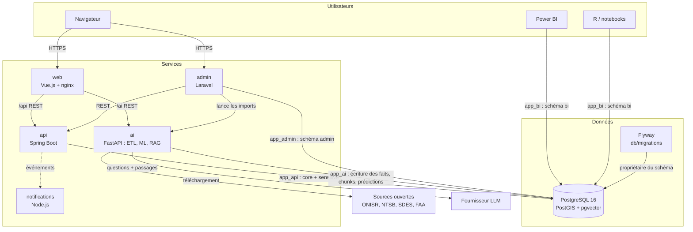

# Diagramme de composants

| Composant | Compte base | Ce qu'il peut faire |
|---|---|---|
| api | `app_api` (rôle `st_api`) | lire et écrire `core`, seul à lire `sensitive` |
| ai | `app_ai` (`st_etl` + `st_ml`) | écrire imports, faits, documents, prédictions, requêtes RAG |
| admin | `app_admin` | ses propres tables dans le schéma `admin` ; les données métier passent par l'API |
| Power BI, R | `app_bi` (`st_bi_reader`) | lire le schéma `bi` uniquement |
| agent IA (jalon 3) | rôle `st_agent_readonly` | lire `core` et `bi`, sans `audit_logs` ni `users` |
