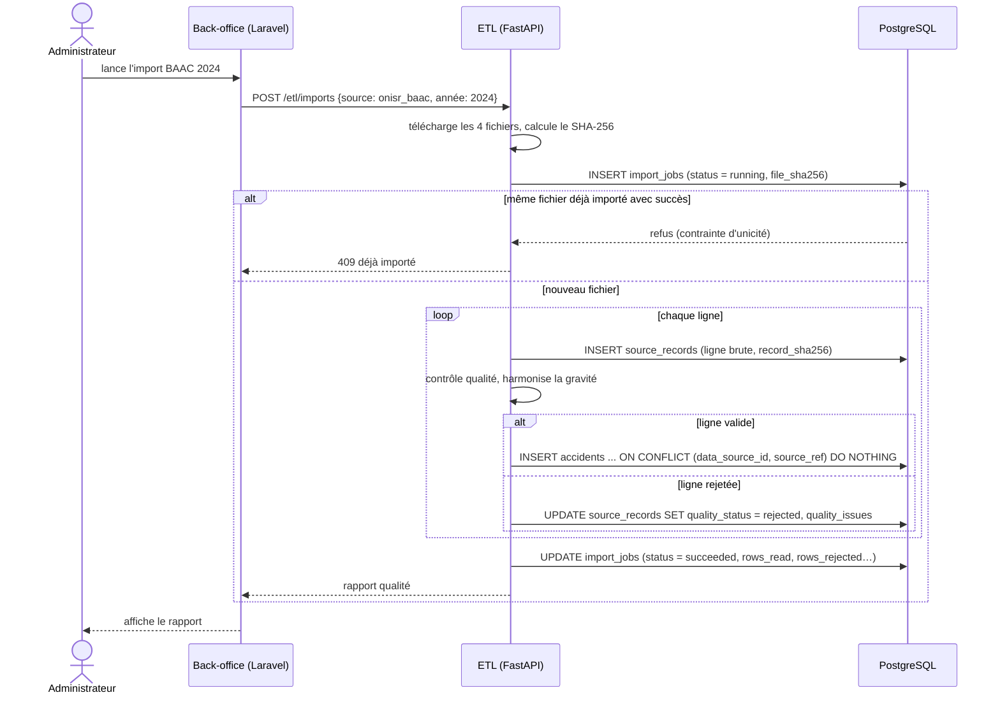
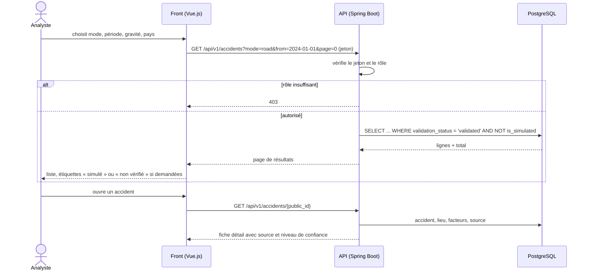
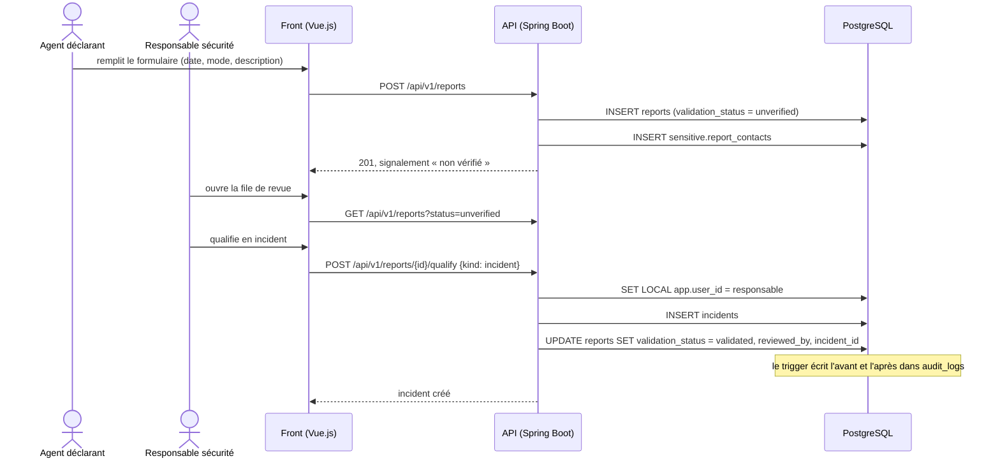
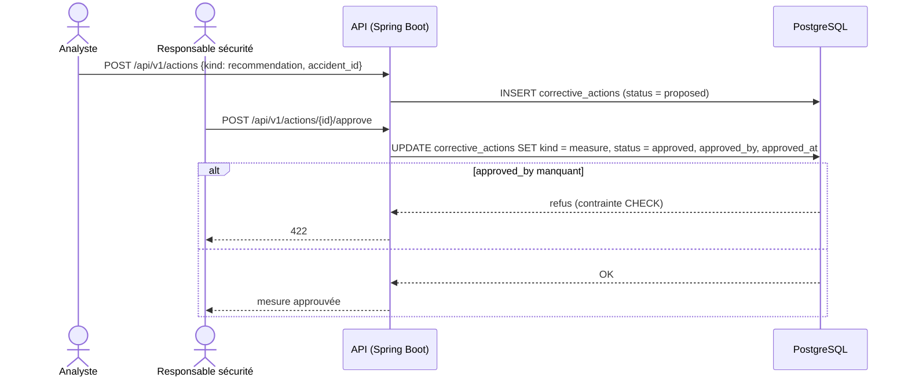
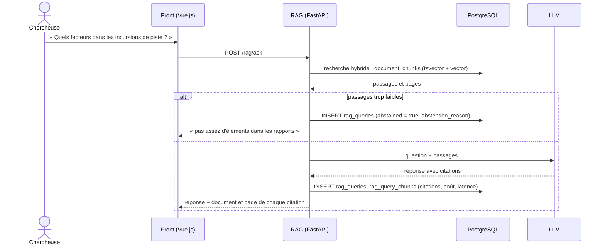

# Diagrammes de séquence

## 1. Importer une année BAAC (US-01, US-03)

## 2. Chercher des accidents (US-05, US-06)

## 3. Déclarer puis qualifier un signalement (US-20, US-21)

## 4. Proposer et approuver une recommandation (US-23)

## 5. Poser une question sur les rapports d'enquête (US-30)

