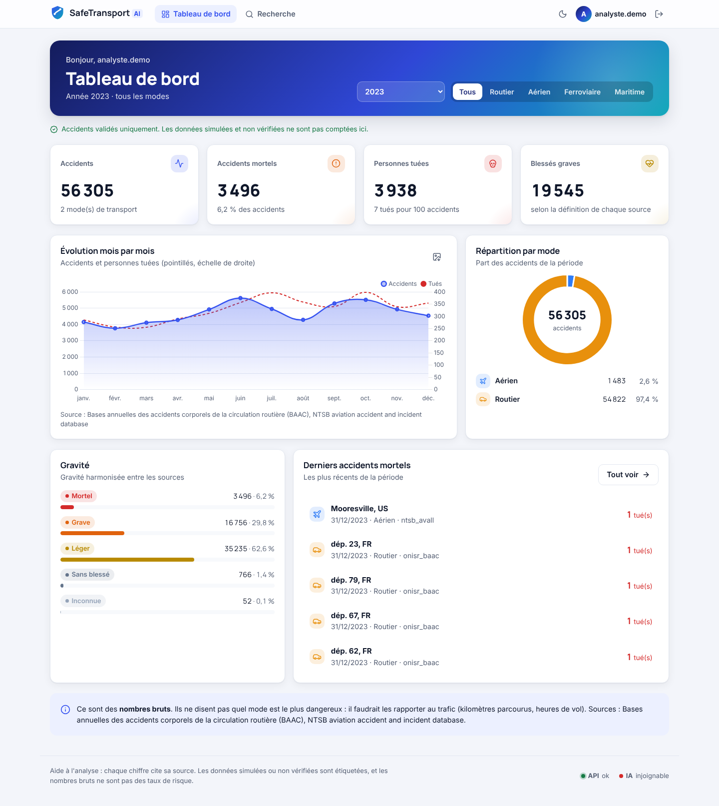
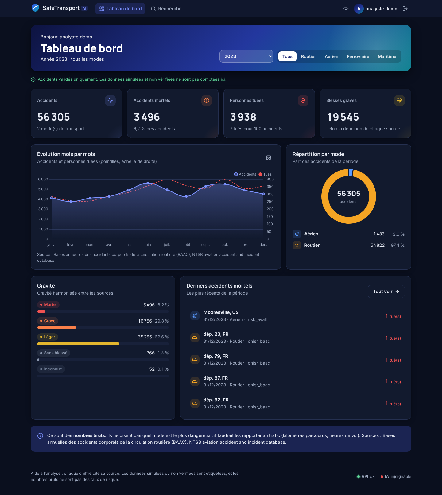
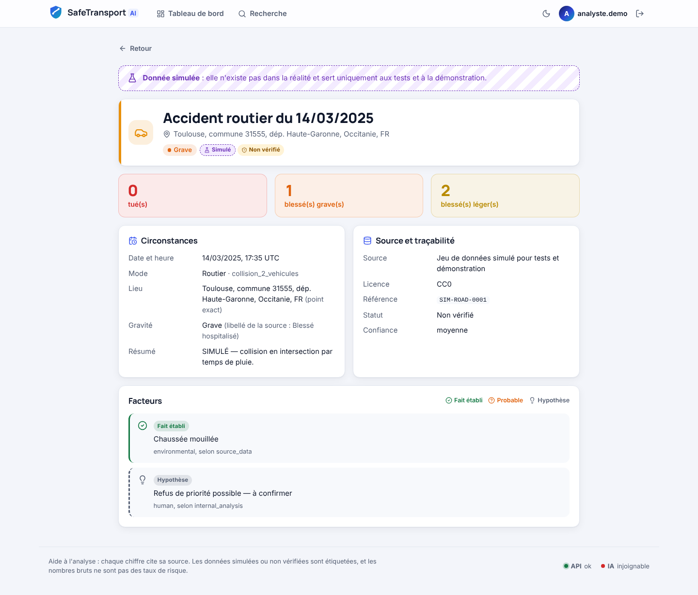
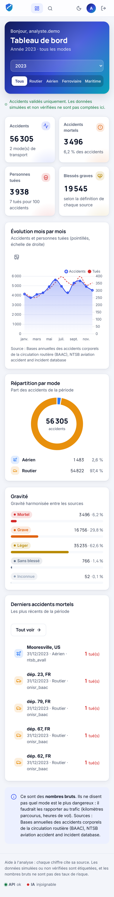

# Phase 09 : interface web (partie MVP)

Le code est dans `web/` (Vue 3, Vite, Vue Router, Chart.js, icônes Lucide, polices Inter et Manrope incluses dans le site). L'interface ne parle qu'à l'API Java.

## Lancer

Le plus simple :

```bash
make web
```

La commande démarre la base, l'API et le site, attend que l'API réponde, affiche le lien
http://localhost:5173 et l'ouvre dans le navigateur. Dans VS Code, la même chose se lance avec
`Cmd+Maj+B` (tâche « Lancer SafeTransportIA » dans `.vscode/tasks.json`). Pour arrêter : `make down`.

Sans make : `docker compose up -d --build api web`, puis ouvrir http://localhost:5173.

Pour travailler sur l'interface avec le rechargement automatique (base et API démarrées) :

```bash
cd web
npm install
npm run dev
```

Vite renvoie `/api` vers l'API sur le port 8080.

## Écrans



- **Connexion** : écran en deux parties, comptes de démonstration en un clic (`analyste.demo`, `resp.securite.demo`, `admin.demo`, mot de passe `demo`). Le jeton reste dans le navigateur 8 heures ; s'il expire, on revient à la connexion.
- **Tableau de bord** (page d'accueil) : accidents, accidents mortels, tués et blessés graves pour l'année et le mode choisis, courbe mois par mois, répartition par mode, barres de gravité, derniers accidents mortels. Seuls les accidents validés et réels sont comptés, et un encadré rappelle que ce sont des nombres bruts, pas des taux de risque.
- **Recherche** : filtres dans une colonne (mode, période, pays, source, gravité, non vérifiés, simulés). Les filtres sont dans l'adresse de la page, donc une recherche se partage par simple copie du lien. Sur téléphone, les filtres s'ouvrent avec un bouton.
- **Graphiques** : la source est écrite sous chaque graphique et dans l'image téléchargée.
- **Liste** : 50 lignes par page, un clic sur une ligne ouvre la fiche, export CSV avec les mêmes filtres. Sur téléphone, chaque ligne devient une petite carte.
- **Fiche détail** : victimes en grand, circonstances, source et traçabilité, facteurs marqués « fait établi », « probable » ou « hypothèse ». Une donnée simulée a un bandeau violet hachuré.
- **Mode sombre** : bouton lune en haut à droite. Sans choix, l'interface suit le réglage du système.

Les étiquettes « Simulé » et « Non vérifié » sont visibles dans la liste et sur la fiche.

| Mode sombre | Fiche d'un accident simulé | Téléphone |
| --- | --- | --- |
|  |  |  |

## Tests

```bash
cd web
npm test
```

Les tests simulent l'API : connexion, tableau de bord, redirection sans jeton ou avec un jeton expiré, filtres envoyés à la liste et au graphique, étiquettes, fiche détail.
