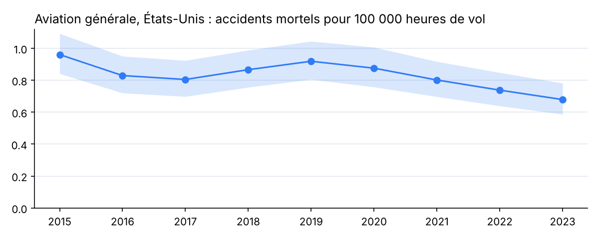
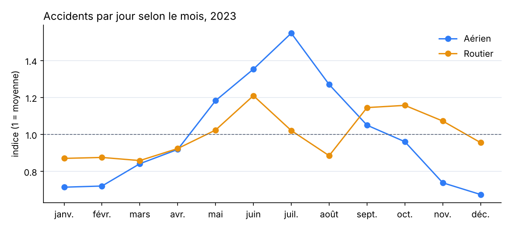

# Phase 10 : statistiques

Le code est dans `analyses/stats/` (Python : psycopg, scipy, matplotlib). Il lit uniquement le schéma `bi`
avec le compte `app_bi` et produit un rapport Markdown reproductible : même base, même commande, mêmes chiffres.

## Lancer

```bash
# 1. dénominateurs d'exposition (une fois, ou après modification du CSV)
cd ai && source .venv/bin/activate
python -m etl.exposition
deactivate && cd ..

# 2. rapport
cd analyses
python3 -m venv .venv && source .venv/bin/activate
pip install -r requirements.txt
python -m stats 2023
```

Le rapport est écrit dans `analyses/output/2023/rapport.md` avec ses graphiques (dossier ignoré par git).
Tests : `cd analyses && pytest -q`.

## Données utilisées

Seuls les accidents **validés** et **non simulés** entrent dans les calculs.

| Numérateur | Source | Périmètre |
|---|---|---|
| Accidents routiers | BAAC 2023 (ONISR, Licence Ouverte) | France métropolitaine (départements 97 et 98 exclus) |
| Accidents d'aviation | NTSB 2015 à 2024 | États-Unis, aviation générale (parties 91, 91K, 133, 135, 137) |

Les dénominateurs sont dans `data/reference/exposition.csv`. Chaque ligne cite le fichier, la feuille et la cellule
d'où vient la valeur, et `python -m etl.exposition` les charge dans `core.exposure_measures` (vue `bi.fact_exposure`,
migration V5).

| Dénominateur | Source | Emplacement |
|---|---|---|
| Véhicules-km, France métropolitaine | SDES, Bilan annuel des transports 2023 | feuille G1.b, ligne 40 « Ensemble des véhicules » (2023 provisoire) |
| Heures de vol, aviation générale et partie 135 | FAA, General Aviation and Part 135 Activity Survey | chapitre 1, tableau 1.3, ligne 47 « All Aircraft » |

Les fichiers bruts restent dans `data/raw/exposition/` (non versionné) : on les retélécharge depuis
<https://www.statistiques.developpement-durable.gouv.fr/bilan-annuel-des-transports-en-2023> et
<https://www.faa.gov/data_research/aviation_data_statistics/general_aviation>.

## Méthodes

* **Taux** : nombre d'événements divisé par l'exposition, ramené à 1 milliard de véhicules-km (route)
  ou à 100 000 heures de vol (aviation), les unités des publications officielles.
* **Intervalle d'un taux** : intervalle exact de Poisson (Garwood), à partir de la loi du khi-deux.
  Il reste valable pour de petits nombres, y compris zéro.
* **Intervalle d'une proportion** (part d'accidents mortels) : Clopper-Pearson, à partir de la loi bêta.
* **Évolution** : rapport des taux entre deux années, avec un intervalle exact conditionnel
  (le nombre de la première année suit une loi binomiale sachant le total).
* **Saisonnalité** : test du khi-deux d'adéquation, les effectifs attendus étant proportionnels au nombre de jours
  du mois (ou au nombre de lundis, mardis… de l'année).

Les fonctions sont dans `analyses/stats/calculs.py` et testées sur des valeurs de référence publiées.

## Résultats 2023

| Indicateur | Nombre | Taux | IC 95 % | Chiffre publié |
|---|---|---|---|---|
| Tués sur la route pour 1 Md véh-km (métropole) | 3 167 | 5,24 | 5,06 – 5,43 | 5,2 (ONISR, bilan 2023, p. 10) |
| Accidents corporels pour 1 Md véh-km | 51 641 | 85,45 | 84,71 – 86,19 | |
| Accidents d'aviation générale pour 100 000 h | 1 156 | 4,05 | 3,82 – 4,29 | 3,86 (AOPA, McSpadden Report) |
| Accidents mortels d'aviation générale pour 100 000 h | 194 | 0,68 | 0,59 – 0,78 | 0,65 (AOPA, McSpadden Report) |

On retrouve les chiffres officiels, ce qui valide à la fois l'import et les dénominateurs. Le nombre de tués
en métropole (3 167) est exactement celui de l'ONISR.

Entre 2015 et 2023, le taux d'accidents mortels de l'aviation générale américaine passe de 0,96 à 0,68
pour 100 000 heures : rapport 0,71 (IC 95 % 0,58 – 0,86).





## Biais et limites

* **On ne compare pas les modes entre eux** : un accident BAAC est tout accident corporel, un accident NTSB
  suppose des dommages importants ou une blessure grave. Seuls les tués (à 30 jours) ont une définition proche,
  et les dénominateurs (véhicules-km, heures de vol) ne se convertissent pas l'un dans l'autre.
* **Sous-déclaration** : le BAAC ne contient que les accidents constatés par les forces de l'ordre.
* **Dénominateurs estimés** : le trafic routier vient d'un modèle (provisoire l'année suivante),
  les heures de vol d'un sondage (erreur type de 1,1 % en 2023). Les intervalles n'en tiennent pas compte.
* **Non-indépendance** : les tués d'un même accident ne sont pas indépendants, l'intervalle sur les tués
  est donc un peu trop étroit. Celui sur les accidents ne l'est pas.
* **Périmètres** : l'outre-mer (231 tués) et l'aviation hors États-Unis sont exclus faute de dénominateur.
* **Description, pas causalité** : un écart entre deux groupes peut venir d'un facteur non mesuré.

Le rapport généré reprend ces points avec les chiffres de l'année demandée (données manquantes, exclusions).
